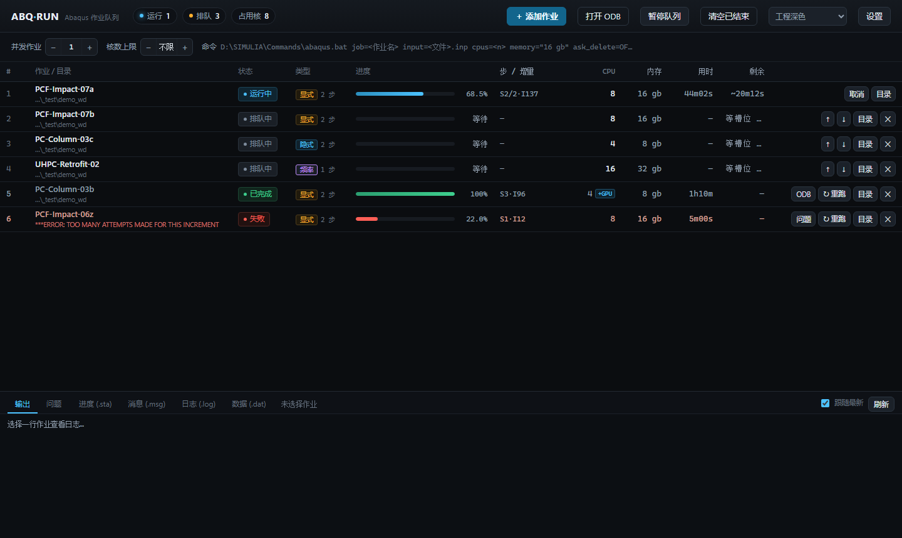

# ABQ-Run

Abaqus `.inp` 作业排队管理器 —— 浏览器界面、单文件后端、绿色免安装。

> **许可**：源码公开，个人学习、教学与非商业科研可免费使用；**商业用途需事先取得作者书面许可**。
> 详见[许可与使用限制](#许可与使用限制)。



## 它解决什么问题

跑参数化算例时，往往有十几个 `.inp` 要依次提交。手动开一堆命令行窗口盯着、等一个跑完再敲下一个，
既费神又容易忘。ABQ-Run 把这些事变成一个队列：

- 把 `.inp` 拖进队列，设定线程数和内存，程序自动依次提交；
- 前一个作业结束才判断下一个能不能开，按你的 CPU 预算排，不会超订；
- 每个作业的进度、增量、用时、剩余时间、错误和警告都在一个页面上。

设计参考了 LS-DYNA 的 **LS-Run**（Java + 私有 JRE）。这里换成 Python 标准库实现，
并自带官方嵌入式运行时，因此同样是「拷过去双击就能用」，但体积只有二十多 MB。

## 特点

- **绿色免安装** —— 自带 `runtime/`（Python 3.12 embeddable），目标机器不需要装 Python。
- **严格 FIFO** —— 队头放不下就整体等待，空出来的核不会硬塞小作业；前面结束后立即重新评估。
- **真实状态判定** —— `abaqus.bat` 分析失败也常常返回退出码 0，所以不只看退出码，
  而是解析 stdout 捕获和 `.log/.sta/.dat/.msg` 综合判定完成 / 失败，并给出失败原因。
- **按分析类型显示进度** —— 隐式/显式看时间和增量，频率分析看模态数，显式作业还能算出剩余时间。
- **问题聚合** —— 把 `.dat/.msg/.sta/.log` 里的 `***ERROR` / `***WARNING` 合并成一个列表，
  自动拼接续行、去重、按严重程度排序，失败原因一眼可见。
- **求解器 / 精度 / GPU** —— 可以指定 abaqus 启动器路径、单双精度、GPU 数量；
  GPU 数量会先实际探测启动器是否支持 `gpus=`、显卡是否可用，再决定要不要放开。
- **打开 ODB** —— 一键调 `abaqus cae` / `abaqus viewer` 打开结果文件。
- **5 套主题** —— 工程深色、Dark+、Dark Modern、Light+、高对比，配色参考 VS Code。
- **断点接管** —— 关掉界面再打开，仍在跑的求解进程会被重新接管，不会误判成中断。

## 快速开始

1. 下载或克隆本仓库（`runtime/` 目录要一起，约 22 MB）。
2. 双击 `ABQ-Run.bat`。
3. 浏览器会自动打开 <http://127.0.0.1:8770/>。
4. 点「添加作业」选择 `.inp`，设好线程数 / 内存 / 精度，确定即可。

如果程序没自动找到 abaqus，启动窗口会提示：

```
[!] 这个 abaqus 现在用不了 —— 点界面上的「设置」选一下 abaqus.bat
```

进「设置 → 求解器」把路径指到 `...\SIMULIA\Commands\abaqus.bat` 就行。

首次启动会在后台探测一次 GPU（十来秒），不影响正常使用。

## 调度规则

队列严格按加入顺序处理，判断条件有两个：

| 条件 | 含义 |
| --- | --- |
| 槽位 | 正在跑的作业数 < 槽位上限（默认 1） |
| 核数 | 已占用核数 + 本作业请求核数 ≤ 核数上限 |

队头作业放不下时，**整队等待**（不会跳过它去跑后面的小作业），等有作业结束再重新判断。
这样能保证大作业不会被无限插队，也符合「先来先跑」的直觉。

排队的实时原因会显示在状态列，例如 `缺 2 核`、`等槽位 1/1`、`等前面作业`、`已暂停`。

## 提交命令

程序实际执行的是：

```bat
abaqus job=<作业名> input=<文件名>.inp cpus=<N> memory="<M>gb" ask_delete=OFF interactive
       [double=explicit|constraint|both] [gpus=<N>] [附加参数]
```

作业在 `.inp` 所在目录下提交，输出文件（`.odb/.dat/.sta/.msg/.log`）也都在那里。

`interactive` 让 abaqus 在前台跑，程序才能捕获输出并判断结束；`ask_delete=OFF` 避免覆盖旧结果时卡在交互提示。

精度选项与 Abaqus 2020 启动器实际接受的参数一致：

| 界面选项 | 参数 |
| --- | --- |
| 单精度（默认） | 不传 |
| 双精度（显式） | `double=explicit` |
| 双精度（约束） | `double=constraint` |
| 双精度（全部） | `double=both` |

## 目录结构

```
ABQ-Run.bat     启动器：优先用 runtime\python.exe，找不到才退回系统 Python
abqrun.py       全部后端代码（单文件，仅标准库）
web/            界面：原生 HTML/CSS/JS，无构建步骤
runtime/        官方 embeddable Python 3.12.10（免安装）
_test/          测试脚本、假求解器、测试用例
_state/         运行时生成的队列状态与日志（不提交）
```

`web/` 里的三个文件是手写的，没有打包工具、没有 npm；改完刷新页面即可看到效果。

## 测试

四套脚本，覆盖调度、核数分配、结果判定和断点恢复：

```bat
runtime\python.exe _test\run_test.py          :: 主流程：入队/取消/判定/重排
runtime\python.exe _test\run_test_cores.py    :: 核数与槽位调度
runtime\python.exe _test\run_test_recover.py   :: 重启后接管
runtime\python.exe _test\test_sta_parse.py    :: .sta 两种排版解析
```

测试用 `_test/fake_abq.bat` 冒充 abaqus（内部是 `fake_solver.py`），不消耗真实求解时间，
也不会碰到正在用的队列（状态目录隔离在 `_test/_state_test/`）。

## 打包绿色版

```bat
runtime\python.exe _test\make_pkg.py
```

生成 `_pkg/ABQ-Run-YYYYMMDD.zip`（约 11 MB），只含运行必需的四项，解压到任意 Windows 机器即可用。

## 已知限制

- **仅 Windows**：依赖 `tasklist`（进程存活判断）、`CREATE_NO_WINDOW`、`winsound`。
- **同一台机器不要同时跑两个 Abaqus/Explicit 作业**：它们会在 `pre.exe` 阶段互相冲突而失败。
  程序本身不会阻止你这么做，请在设置里把槽位保持为 1。
- **GPU 加速只对 Abaqus/Standard 的直接求解器有意义**，Explicit 不支持；
  消费级显卡 FP64 算力很低，通常看不到明显加速，专业卡才有实际收益。

## 许可与使用限制

本项目源码公开，**但并非 OSI 定义的开源许可**：允许个人学习、教学和非商业科研使用，
**商业用途需事先取得作者许可**。

### 允许

- 个人学习、教学、学术研究等非商业用途，可自由阅读和修改源码；
- 在非商业项目中引用或二次开发，需保留本许可条款与作者署名；
- 转载本项目或衍生作品，需注明来源并附上本许可条款。

### 未经许可不得

- 将本项目或其衍生版本用于任何**商业用途**，包括但不限于：
  - 在企业内部用于生产经营、承接商业工程项目；
  - 集成进商业软件或硬件产品对外销售；
  - 以此为基础提供付费的技术服务、咨询或外包交付；
  - 部署于商业培训、商业云服务。

### 商业授权

如需商业使用，请通过本仓库的 Issue 联系作者取得书面许可，说明使用场景与范围。

### 免责声明

本程序仅作为作业调度辅助工具，不对任何计算结果、工程结论或由此产生的损失负责。
求解设置与分析结果的正确性请自行确认。

## 第三方

`runtime/` 是 Python 官方 embeddable 发行版，遵循 PSF License，详见 `runtime/LICENSE.txt`。
该许可仅覆盖 Python 运行时本身，不影响本项目自身的上述使用限制。
